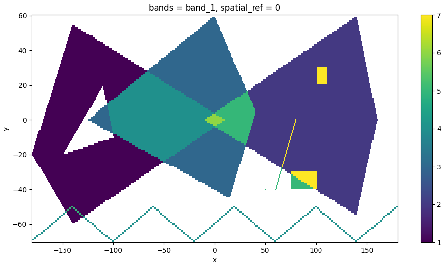

# rusterize in Python

**rusterize** is designed to work on _all_ shapely geometries, even when they are nested inside complex geometry collections. Functionally, it supports four input types:

- [geopandas](https://geopandas.org/en/stable/) GeoDataFrame and GeoSeries
- [polars-st](https://oreilles.github.io/polars-st/) GeoDataFrame
- Python list of geometries in shapely.Geometry, WKB, or WKT format
- Numpy array of geometries in shapely.Geometry, WKB, or WKT format

It returns a [xarray](https://docs.xarray.dev/en/stable/), a [numpy](https://numpy.org/), or a custom sparse array in COOrdinate format.

## Installation

**rusterize** comes with `numpy` as the only required dependency and is distributed in different flavors. A `core` library that performs the rasterization and returns
a bare `numpy` array, a `xarray` flavor that returns a georeferenced `xarray` (requires `xarray` and `rioxarray` and is the recommended flavor), or an `all` flavor with
dependencies for all supported inputs.

Install the current version with pip:

```bash
# core library
pip install rusterize

# xarray capabilities
pip install 'rusterize[xarray]'

# support all input types
pip install 'rusterize[all]'
```

## Usage

Visit the full [API reference](python_api.md).

```python
from rusterize import rusterize
import geopandas as gpd
from shapely import wkt
import matplotlib.pyplot as plt

# construct geometries
geoms = [
    "POLYGON ((-180 -20, -140 55, 10 0, -140 -60, -180 -20), (-150 -20, -100 -10, -110 20, -150 -20))",
    "POLYGON ((-10 0, 140 60, 160 0, 140 -55, -10 0))",
    "POLYGON ((-125 0, 0 60, 40 5, 15 -45, -125 0))",
    "MULTILINESTRING ((-180 -70, -140 -50), (-140 -50, -100 -70), (-100 -70, -60 -50), (-60 -50, -20 -70), (-20 -70, 20 -50), (20 -50, 60 -70), (60 -70, 100 -50), (100 -50, 140 -70), (140 -70, 180 -50))",
    "GEOMETRYCOLLECTION (POINT (50 -40), POLYGON ((75 -40, 75 -30, 100 -30, 100 -40, 75 -40)), LINESTRING (60 -40, 80 0), GEOMETRYCOLLECTION (POLYGON ((100 20, 100 30, 110 30, 110 20, 100 20))))"
]

# create a GeoDataFrame with shapely geometries from WKT
gdf = gpd.GeoDataFrame({'value': range(1, len(geoms) + 1)}, geometry=wkt.loads(geoms), crs='EPSG:32619')

output = rusterize(
    gdf,
    res=(1, 1),
    field="value",
    fun="sum",
).squeeze()

# plot it
fig, ax = plt.subplots(figsize=(12, 6))
output.plot.imshow(ax=ax)
plt.show()
```



You could also create a multiband output by specifing the `by` parameter.

```python
gdf["by"] = ["a", "a", "b", "b", "c"]

output = rusterize(
    gdf,
    res=(1, 1),
    field="value",
    by="by",
    fun="sum",
)
```

Alternatively, you can pass raw values to burn on the final raster, one per geometry.

```python
import numpy as np

output = rusterize(
    geoms,
    res=(1, 1),
    fun="sum",
    burn=np.arange(1, len(geoms) + 1)
).squeeze()
```

Finally, you can also create a [`SparseArray`](python_api.md#sparsearray), that is an object storing the band/row/col value triplets of all pixels that will be materialized in a final raster.

```python
output = rusterize(
    gdf,
    res=(1, 1),
    field="value",
    fun="sum",
    encoding="sparse"
)
output
# SparseArray:
# - Shape: (1, 131, 361)
# - Extent: (-180.5, -70.5, 180.5, 60.5)
# - Resolution: (1.0, 1.0)
# - EPSG: 32619
# - Estimated size: 378.33 KB

# materialize into xarray or numpy
array = output.to_xarray()
array = output.to_numpy()

# get only coordinates and values
output.to_frame()
# shape: (29_363, 3)
# ┌─────┬─────┬────────┐
# │ row ┆ col ┆ values │
# │ --- ┆ --- ┆ ---    │
# │ u64 ┆ u64 ┆ f64    │
# ╞═════╪═════╪════════╡
# │ 6   ┆ 40  ┆ 1.0    │
# │ 6   ┆ 41  ┆ 1.0    │
# │ 6   ┆ 42  ┆ 1.0    │
# │ 7   ┆ 39  ┆ 1.0    │
# │ 7   ┆ 40  ┆ 1.0    │
# │ …   ┆ …   ┆ …      │
# │ 39  ┆ 286 ┆ 5.0    │
# │ 39  ┆ 287 ┆ 5.0    │
# │ 39  ┆ 288 ┆ 5.0    │
# │ 39  ┆ 289 ┆ 5.0    │
# │ 39  ┆ 290 ┆ 5.0    │
# └─────┴─────┴────────┘
```

## Benchmarks

**rusterize** is fast! Let's compare it with GDAL, `rasterio`, and `geocube` on small and large datasets ([benchmark_rusterize.py](https://github.com/ttrotto/rusterize/blob/main/python/benchmarks/benchmark_rusterize.py)):

- **water**: 458,295 lake polygons from CanVec (British Columbia), burned as `float64` at 1/600° (~185 × 105 m). `small` is the first 1,000 lakes, `large` is all of them.
- **roads**: 2.25M road lines from the Canadian road network, burned as `uint8` at 100 m.

You can run this with [pytest](https://docs.pytest.org/en/stable/) and [pytest-benchmark](https://pytest-benchmark.readthedocs.io/en/stable/):

```
pytest python/benchmarks/benchmark_rusterize.py --benchmark-min-rounds=10 --benchmark-time-unit='s'
```

| Name (time in s)                     |     Min |     Max |    Mean | StdDev |  Median |    IQR | Outliers |     OPS | Rounds | Iterations |
| ------------------------------------ | ------: | ------: | ------: | -----: | ------: | -----: | -------: | ------: | -----: | ---------: |
| test_water_small_rusterize_f64_numpy |  0.0234 |  0.0261 |  0.0245 | 0.0010 |  0.0240 | 0.0019 |      7;0 | 40.8730 |     17 |          1 |
| test_water_small_rusterize_f64       |  0.0572 |  0.1102 |  0.0783 | 0.0220 |  0.0767 | 0.0375 |      1;0 | 12.7754 |     10 |          1 |
| test_water_small_rasterio_f64        |  0.1614 |  0.1755 |  0.1644 | 0.0047 |  0.1618 | 0.0048 |      2;1 |  6.0846 |     10 |          1 |
| test_water_small_gdal_f64            |  0.2003 |  0.2062 |  0.2023 | 0.0022 |  0.2014 | 0.0032 |      2;0 |  4.9422 |     10 |          1 |
| test_water_small_geocube_f64         |  0.2018 |  0.2054 |  0.2027 | 0.0010 |  0.2024 | 0.0004 |      1;1 |  4.9336 |     10 |          1 |
| test_water_large_rusterize_f64_numpy |  1.5394 |  1.8718 |  1.6995 | 0.0978 |  1.6744 | 0.0257 |      3;3 |  0.5884 |     10 |          1 |
| test_roads_rusterize_uint8           |  1.5993 |  1.8498 |  1.6906 | 0.0986 |  1.6509 | 0.1911 |      3;0 |  0.5915 |     10 |          1 |
| test_water_large_rusterize_f64       |  1.6421 |  1.7928 |  1.7359 | 0.0502 |  1.7507 | 0.0106 |      3;3 |  0.5761 |     10 |          1 |
| test_water_large_gdal_f64            |  2.6929 |  2.9174 |  2.7478 | 0.0729 |  2.7103 | 0.0651 |      2;1 |  0.3639 |     10 |          1 |
| test_roads_gdal_uint8                |  4.9994 |  5.2544 |  5.1429 | 0.1032 |  5.1632 | 0.1852 |      5;0 |  0.1944 |     10 |          1 |
| test_water_large_rasterio_f64        | 14.3940 | 14.7211 | 14.5387 | 0.1042 | 14.5063 | 0.1438 |      3;0 |  0.0688 |     10 |          1 |
| test_water_large_geocube_f64         | 15.1772 | 15.5589 | 15.3685 | 0.1309 | 15.3336 | 0.2235 |      3;0 |  0.0651 |     10 |          1 |

### Comparison with other tools

While **rusterize** is fast, there are other fast alternatives out there, including `rasterio` and `geocube`. However, **rusterize** allows for a seamless,
Rust-native processing with similar or lower memory footprint that **does not** require you to install GDAL and returns the geoinformation you need for downstream
processing with ample control over resolution, shape, extent, data type, and encoding.

On the large water bodies dataset, **rusterize** returns a georeferenced `xarray` in 1.75 s (median of 10 runs): **1.5×** faster than GDAL, and **8.3×** and **8.8×**
faster than `rasterio` and `geocube`. On the 2.25M road lines it is **3.1×** faster than GDAL, and on the small dataset it is **2.1–2.6×** faster than all three.
Returning a plain `numpy` array instead of an `xarray` is faster still.

| Speedup of **rusterize** (median) | vs GDAL | vs rasterio | vs geocube |
| --------------------------------- | ------: | ----------: | ---------: |
| water small                       |    2.6× |        2.1× |       2.6× |
| water large                       |    1.5× |        8.3× |       8.8× |
| roads                             |    3.1× |           – |          – |

For a fair comparison, every tool burns a value of 1 onto a single band over the same grid, and `geocube` is given a single column to rasterize.
